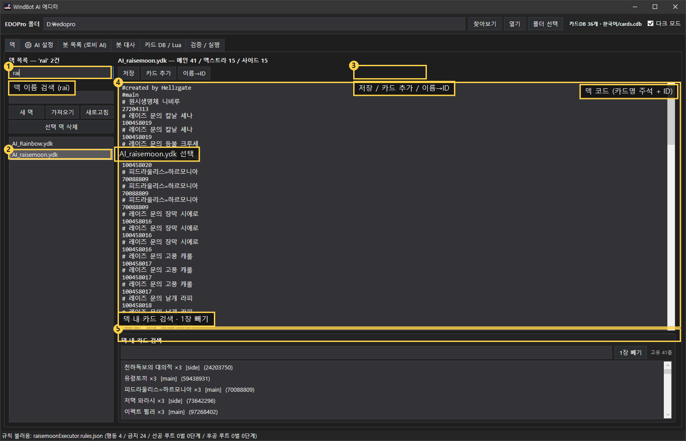
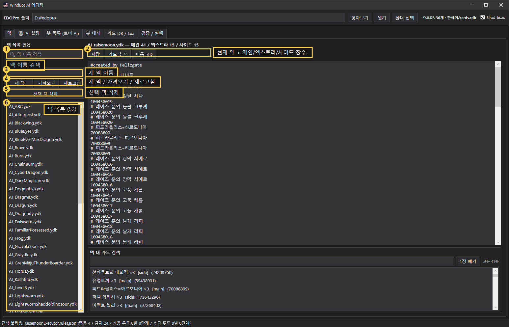
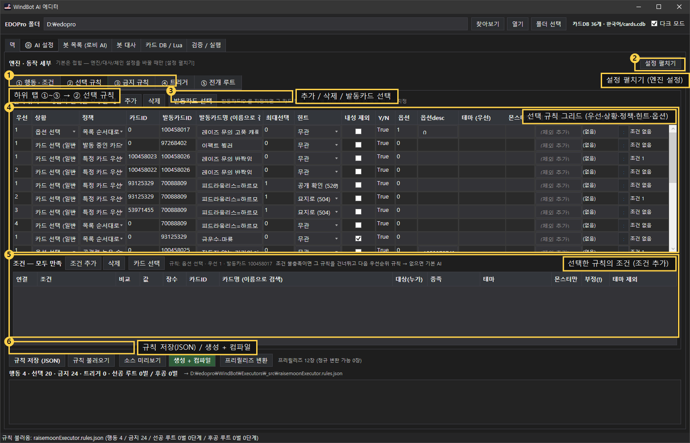
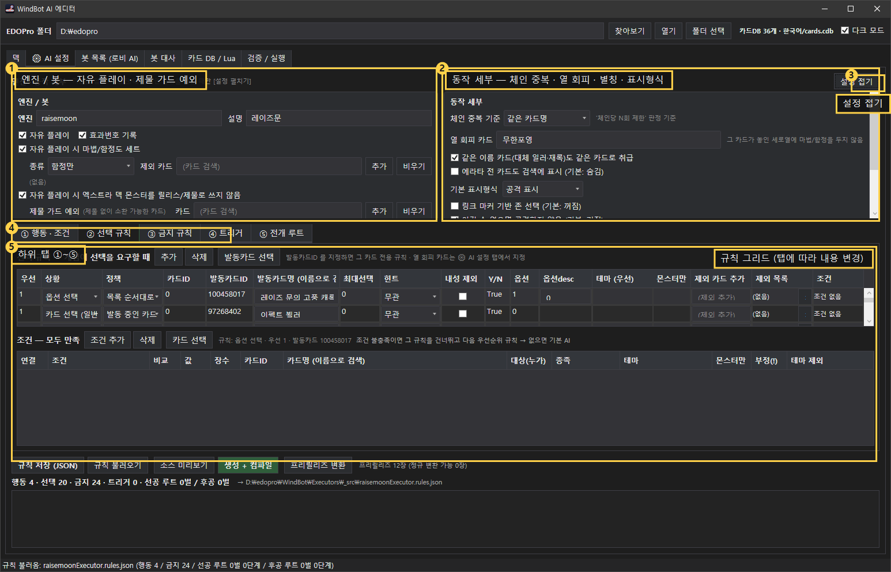
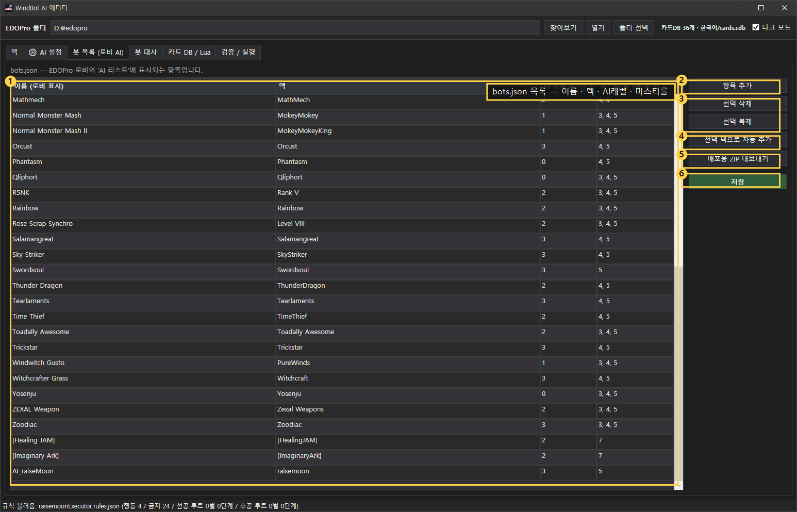
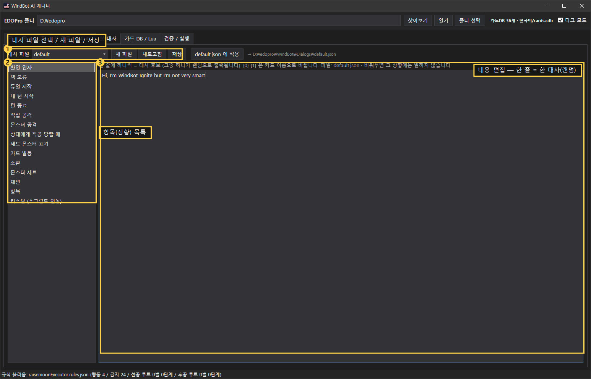
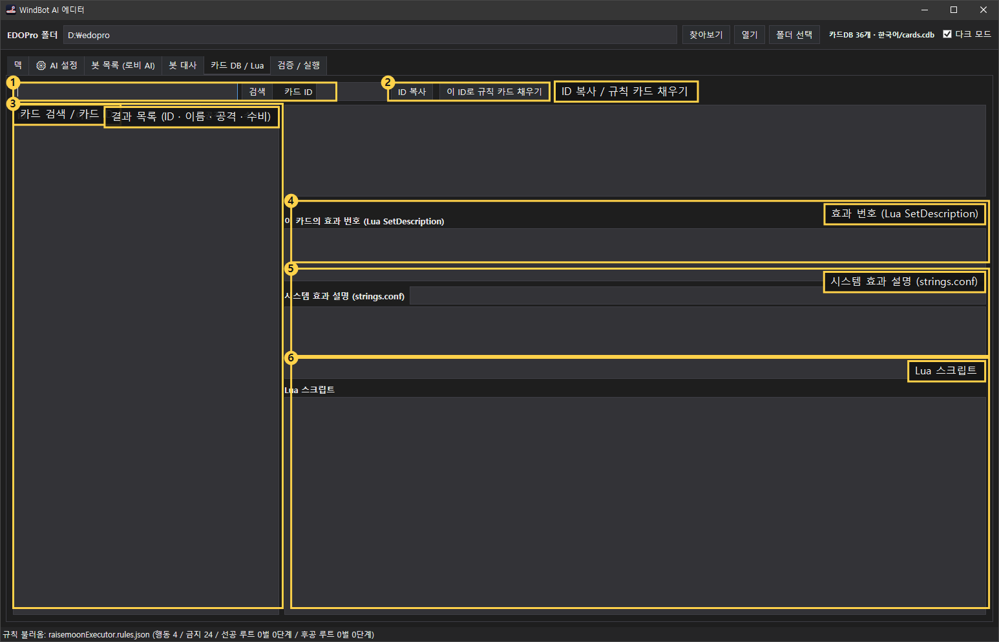
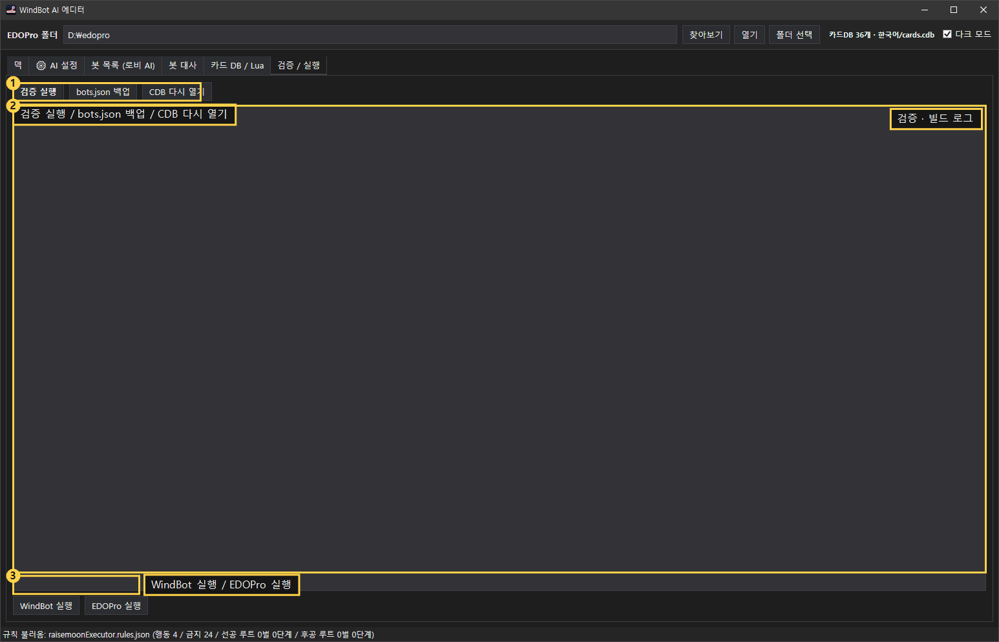

# 사진으로 따라하는 WindBot AI 에디터 (레이즈문 봇 만들기)

> 근거 문서: `MANUAL.md` (같은 앱의 정식 설명서). 이 튜토리얼은 **화면 사진 8장 = 8단계**로 재구성한 실습판입니다.
> 각 단계 끝의 `→ 매뉴얼 §n` 을 펼치면 같은 내용을 더 자세히 볼 수 있습니다.

**대상**: 처음 쓰는 사람 / **목표**: 덱을 열고 → 규칙 한 줄 추가 → 컴파일 → 로비에 봇 등록까지
**예시 봇**: `AI_raisemoon` (레이즈문, 메인 41 · 엑스트라 15 · 사이드 15)

---

## 0. 준비물

| 항목 | 확인 |
|---|---|
| EDOPro 설치 | 상단 **`EDOPro 폴더`** 칸에 경로가 보이면 정상 (예: `D:\edopro`) |
| 카드 DB | 상단 **`카드 DB 367`** 처럼 숫자가 보이면 로드 완료 |
| 화면 크기 | 최소 1100×700. 규칙 탭은 좁으면 안에서 스크롤됩니다 |

---

## 1. 덱 확인 · 다른 덱 불러오기 — 사진 `step01`, `step02` → 매뉴얼 §5

**목표**: 봇이 쓸 `.ydk` 를 고르고, 장수를 확인한다.



| 순서 | 누를 곳 | 결과 |
|---|---|---|
| ① | 왼쪽 **`덱 이름 검색`** 에 `rai` 입력 | 목록이 `AI_raisemoon.ydk` 하나로 좁혀짐 |
| ② | 목록에서 **`AI_raisemoon.ydk`** 클릭 | 오른쪽에 덱 코드가 열림 |
| ③ | (필요 시) **`저장` / `카드 추가` / `이름→ID`** | 카드명을 ID로 일괄 변환 |
| ④ | 오른쪽 편집기 | `#main` · `#extra` · `!side` 구역과 카드 ID |
| ⑤ | 아래 **`덱 내 카드 검색`** + **`1장 빼기`** | 덱 안에서 카드 찾아 제거 |

**확인 포인트**
- 제목줄 `AI_raisemoon.ydk — 메인 41 / 엑스트라 15 / 사이드 15` → **권장 범위**(메인 40~60, 엑스트라 ≤15, 사이드 ≤15) 안
- 사이드 구분자는 반드시 **`!side`** ( `#!side` 는 게임이 **주석**으로 처리 → 사이드가 엑스트라로 들어갑니다 )



새 덱을 만들 때는 **`새 덱 이름`** 입력 → **`새 덱`**, 기존 파일을 가져오려면 **`가져오기`**, 지우려면 목록 선택 후 **`선택 덱 삭제`**.

---

## 2. AI 설정 탭 열기 — 사진 `step03` → 매뉴얼 §4 · §6

**목표**: 규칙 편집 화면(①~⑤)으로 들어간다.



| 순서 | 누를 곳 | 결과 |
|---|---|---|
| ① | 상단 탭 **`⚙ AI 설정`** | 설정 카드 + 규칙 서브탭이 나옴 |
| ② | **`[설정 펼치기]`** (오른쪽 위) | 엔진/동작 세부 카드가 펼쳐짐 — **기본은 접힘** |
| ③ | 서브탭 **①②③④⑤** | ①행동·조건 / ②선택 / ③금지 / ④트리거 / ⑤전개 루트 |
| ④ | **`추가` / `삭제`** | 규칙 한 줄 추가·제거 |

> 규칙은 **탭별로 따로** 저장됩니다. 하단 **`규칙 저장 (JSON)`** 을 눌러야 파일에 기록됩니다.

---

## 3. 설정 카드에서 자주 쓰는 옵션 — 사진 `step04` → 매뉴얼 §6-1 · §6-2



| 영역 | 대표 항목 | 언제 쓰나 |
|---|---|---|
| **엔진 / 봇** | `자유 플레이` | 규칙에 없는 카드도 알아서 소환·발동 |
| | `자유 플레이 시 마법/함정도 세트` | 함정·속공이 패에 썩는 문제 해결 |
| | `자유 플레이 시 엑스트라 덱 몬스터를 릴리스/제물로 쓰지 않음` | 엑시즈를 제물로 바치는 사고 방지 (기본 ON) |
| | **`제물 가드 예외`** | 제물이 없어도 소환해야 하는 카드 (예: 캐롤 100458017 — 무제물 일반소환) |
| **동작 세부** | `체인 중복 기준` | 같은 카드 체인 반복 방지 (카드ID/이름/테마) |
| | `열 회피 카드` | 상대 무한포영 열에 마함 놓지 않기 |
| | `같은 이름 카드(대체 일러/재록)도 같은 카드로 취급` | 금지·행동이 다른 ID에도 적용 |
| | `기본 표시형식` | 규칙에 표시형식이 없을 때 공격/수비 |
| | `이길 수 없으면 공격하지 않음` | 자멸 공격 방지 (기본 ON) |

**입력 방법**: 카드가 필요한 칸은 **카드명을 검색해 고르고 `추가`**, 목록은 `비우기`로 초기화.

---

## 4. ② 선택 규칙에 한 줄 추가 (실전 예시: 캐롤 무제물 소환) — 사진 `step03` → 매뉴얼 §8

**목표**: "캐롤(100458017)이 뜨는 옵션 창에서 **무제물 일반소환**을 고른다".


| 칸 | 넣을 값 | 이유 |
|---|---|---|
| **우선** | `1` | 낮을수록 먼저 |
| **상황** | `옵션 선택` | 엔진이 "소환 방법"을 물을 때 |
| **정책** | `목록 순서대로` | 옵션은 **옵션** 칸이 결정 |
| **발동카드ID** | `100458017` | 카드명이 자동 표시됨 (`레이즈 문의 고풍 캐롤`) |
| **힌트 / 최대선택 / 내성 제외** | `무관` / `0` / 해제 | 이 프롬프트는 힌트를 쓰지 않음 |
| **옵션** | **`1`** | **0 = 제물 소환, 1 = 무제물 소환** (엔진 고정 순서) |

**저장 순서**
1. **`추가`** → 새 줄 생성 → 위 값 입력
2. 하단 **`규칙 저장 (JSON)`**
3. **`생성 + 컴파일`** ← 이걸 눌러야 실행기 DLL이 새로 만들어집니다
4. **EDOPro 완전 재시작** (WindBot은 시작할 때 `Executors\*.dll` 을 한 번만 읽습니다)

**조건을 붙이고 싶으면** 아래 **조건 그리드**에서 `조건 추가` → 예: `내 필드 몬스터 수 ≥ 1`, `이번 턴 특수소환 0회` 등.

> ⚠ 순서 주의: **`생성 + 컴파일` 없이 `규칙 저장`만 하면 게임에 반영되지 않습니다.**

---

## 5. 봇 목록(로비 AI)에 등록 — 사진 `step05` → 매뉴얼 §12



> 왼쪽 큰 박스가 **목록**이고, 오른쪽 버튼은 위에서부터 **②항목 추가 · ③선택 삭제/복제 · ④덱으로 자동 추가 · ⑤배포용 ZIP 내보내기 · ⑥저장** 입니다.

| 순서 | 누를 곳 | 결과 |
|---|---|---|
| ① | **`항목 추가`** | 빈 행 추가 |
| ② | `이름(로비 표시)` / `덱` / `AI 레벨(0~3)` / `마스터 룰(예: 4, 5)` 입력 | 예: `AI_raiseMoon` / `raisemoon` / `3` / `5` |
| ③ | **`저장`** | `bots.json` 기록 → **EDOPro 재시작** 후 로비에 표시 |
| ④ | **`선택 덱으로 자동 추가`** | 덱 이름만 넣고 한 번에 행 생성 |
| ⑤ | **`배포용 ZIP 내보내기`** | 남에게 줄 **7파일** 패키지 생성 |

**체크**: `이름` 은 로비에 보이는 이름, `덱` 은 **확장자 없는** 엔진 이름(`raisemoon`)입니다.

---

## 6. 봇 대사 — 사진 `step06` → 매뉴얼 §13



| 순서 | 누를 곳 | 결과 |
|---|---|---|
| ① | **`대사 파일`** 콤보 | `default` 등 사용할 파일 선택 |
| ② | 왼쪽 **항목 목록** (확영 인사·덱 오류·소환…) | 상황별 대사 편집 |
| ③ | 오른쪽 편집기 | **한 줄 = 한 대사** (여러 줄이면 그중 하나가 랜덤) |
| ④ | **`저장`** → **`default.json 에 적용`** | `WindBot\Dialogs\*.json` 에 반영 |

**주의**: `{0}`, `{1}` 은 카드 이름으로 바뀝니다. EDOPro는 `Dialog=` 를 넘기지 않으므로 **실행기 DLL이 런타임에 교체**합니다 (앱이 자동 처리).

---

## 7. 카드 DB / Lua — 카드 ID·효과 번호 찾기 — 사진 `step07` → 매뉴얼 §14



| 순서 | 누를 곳 | 결과 |
|---|---|---|
| ① | **`카드 검색`** 에 이름 입력 → **`검색`** | 후보 목록 |
| ② | 목록에서 카드 클릭 | 오른쪽에 상세 |
| ③ | **`카드 ID`** 칸 + **`ID 복사`** | 규칙에 붙여넣기 |
| ④ | **`이 ID로 규칙 카드 채우기`** | ②·③ 그리드의 카드 칸에 자동 입력 |
| ⑤ | **`효과 번호 (Lua SetDescription)`** | ① 행동의 **효과번호** 필터 값 |
| ⑥ | **`Lua 스크립트`** | 그 카드가 실제로 하는 동작 확인 |

**팁**: 카드가 **프리릴리즈**면 배지가 뜹니다 → ⚙ AI 설정 **`[프리릴리즈 변환]`** 으로 정규 ID로 바꾸세요.

---

## 8. 마무리 — 검증 · 실행 — 사진 `step08` → 매뉴얼 §15



| 순서 | 누를 곳 | 결과 |
|---|---|---|
| ① | **`검증 실행`** | 덱/규칙/bots.json/DLL 일관성 검사 로그 |
| ② | **`bots.json 백업`** | 사고 전 `.bak` 확보 |
| ③ | **`CDB 다시 열기`** | 카드 DB 갱신(프리릴리즈 반영 후) |
| ④ | **`WindBot 실행` / `EDOPro 실행`** | 바로 듀얼 테스트 |

**성공 신호 (WindBot 콘솔)**: `Deck found, loading AI_raisemoon`

---

## 9. 자주 막히는 곳 (매뉴얼 §18 요약)

| 증상 | 원인 | 조치 |
|---|---|---|
| 로비에 봇이 안 보임 | `bots.json` 항목 없음 / EDOPro 미재시작 | §5 등록 후 **완전 재시작** |
| 랜덤 덱으로 나옴 | `[Deck("...")]` 이름과 덱 파일명 불일치 | 덱 파일명 `AI_<엔진>.ydk` 확인 |
| 규칙을 고쳤는데 그대로 | **`생성 + 컴파일`** 안 함 / 재시작 안 함 | 컴파일 → 재시작 |
| "잘못된 응답" 오류 | 선택 콜백이 `max` 무시 | 규칙의 `최대선택` 확인 |
| 옵션이 엉뚱하게 선택됨 | 같은 카드가 옵션을 두 번 띄움 | **`옵션desc`** 로 구분 |
| 대사가 안 나옴 | 대사 파일 미적용 | §6 `default.json 에 적용` |
| 엑시즈를 제물로 바침 | 제물 여력 가드 | §3 `엑스트라 덱 … 쓰지 않음` ON |
| 무제물 소환 카드가 안 나옴 | 제물 부족으로 소환 시도 자체가 막힘 | §3 **`제물 가드 예외`** 에 카드 추가 |

---

## 10. 이미지 관리 (제작자용)

```
docs/tutorial/
  TUTORIAL.md              ← 이 문서
  shots/step01~08*.png     ← 원본 사진 (그대로 보관)
  img/step01~08*-marked.png ← 번호·라벨을 입힌 이미지 (문서가 참조)
```

**다시 뽑기 / 좌표 고치기**
```powershell
powershell -NoProfile -ExecutionPolicy Bypass -File ".\_tools\annotate.ps1" `
  -Dir "WindBotAIEditor\docs\tutorial\shots" -Out "WindBotAIEditor\docs\tutorial\img"
```
- 좌표는 `_tools/tutorial-shots.json` 에 **0~1 비율**로 저장 → 사진 해상도가 달라도 자동 환산
- `side` 로 라벨 위치를 강제할 수 있습니다: `inside-left` / `inside-right` / `right` / `left` / `below` / `above`
- `label` 을 빈 문자열로 두면 **번호만** 표시 (버튼이 촘촘한 곳)
- 스타일 미리보기(사진 없이): `-Sample -Only step03-choice` → `_tools/sample/sample-step03-choice.png`
- 원본 사진을 새로 찍었으면 **같은 파일명**으로 덮어쓰고 위 명령만 다시 실행하면 됩니다 (문서 수정 불필요)

